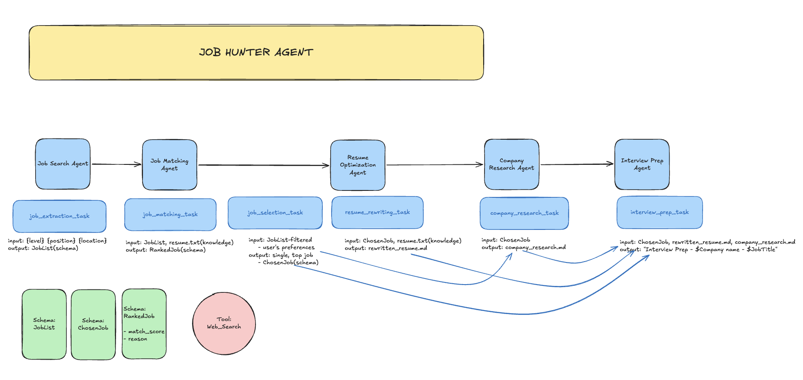

# Job Hunter Agent

A CrewAI crew that searches for a role, scores it against a resume, then writes the application materials.

<p align="center">
  <a href="workflow.png">
    
  </a>
</p>

<p align="center">
  <sub>Blue is the crew. Green is the output schema. Pink is the web search tool.</sub>
</p>

| Step | Task | Reads | Writes |
| --- | --- | --- | --- |
| 1 | `job_extraction_task` | level, position, location | `JobList` |
| 2 | `job_matching_task` | `JobList`, resume | `RankedJobList` |
| 3 | `job_selection_task` | ranked jobs, preferences | `ChosenJob` |
| 4 | `resume_rewriting_task` | chosen job, resume | `output/rewritten_resume.md` |
| 5 | `company_research_task` | chosen job | `output/company_research.md` |
| 6 | `interview_prep_task` | chosen job, resume, research | `output/interview_prep.md` |

## Run

```bash
uv sync
uv run main.py
```

Put `OPENAI_API_KEY` and `FIRE_CRAWL_API_KEY` in `.env`. Kickoff inputs (`level`, `position`, `location`) live at the bottom of `main.py`.
